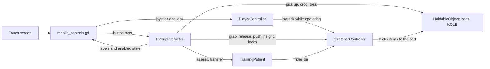
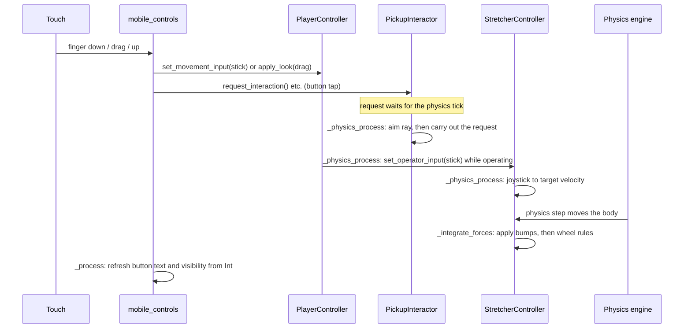
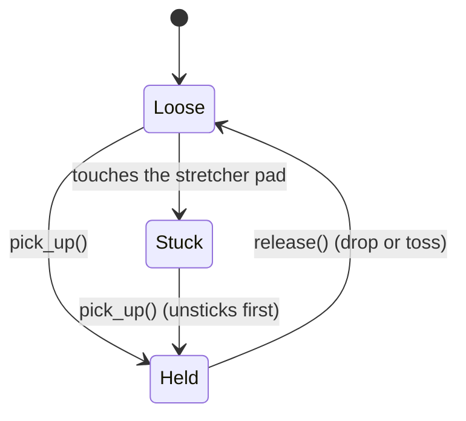
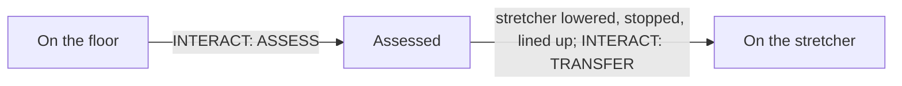

# How the Code Works

A guide to the Paramedic Simulator prototype for someone who can program but has not seen this project. Read this first, then the script you want to change. Every script also starts with a short summary of its own.

**Engine:** Godot 4.7, Mobile renderer, GDScript only (Xogot on iPad cannot run C# or compiled add-ons).
**State described:** after the 2026-11-27 merge of the approved fixes and the readability cleanup.

---

## 1. The big picture

There is one scene, `scenes/main/main.tscn`: a training floor with a player, a stretcher, two bags, the KOLE defibrillator and a training patient.

Seven scripts do all the work:

| Script | Class | Job in one line |
|---|---|---|
| `ui/mobile_controls.gd` | (none) | Turns touches into joystick values and button presses, and draws the on-screen controls. |
| `scripts/player/player_controller.gd` | `PlayerController` | Walks and looks. While operating the stretcher, stands at its handle and passes the joystick on. |
| `scripts/interaction/pickup_interactor.gd` | `PickupInteractor` | Knows what the player is aiming at, and carries out button presses on the next physics tick. |
| `scripts/interaction/holdable_object.gd` | `HoldableObject` | Base for anything carryable: loose, held in hand, or stuck to the stretcher pad. |
| `scripts/equipment/defibrillator.gd` | `Defibrillator` | KOLE: a holdable whose screen cracks on a hard impact, except on the pad. |
| `scripts/stretcher/stretcher_controller.gd` | `StretcherController` | The stretcher: driving, caster locks, sticky pad, LOWER/RAISE, PUSH, bumps. |
| `scripts/patient/training_patient.gd` | `TrainingPatient` | The patient: ASSESS, then TRANSFER onto a lowered, lined-up stretcher. |

**The one rule that keeps it simple:** input flows one way.



- The UI never moves anything itself. It only calls methods on the player and the interactor.
- The player and the interactor never read touches. They get plain numbers and requests.
- So the touch UI can be replaced (for example by the Virtual Joystick add-on) without touching gameplay.

---

## 2. The scene tree

```
Main (Node3D)
├── WorldEnvironment, DirectionalLight3D
├── TrainingFloor (StaticBody3D, 24 x 24 m, top at y = 0)
├── ObstacleA, ObstacleB (StaticBody3D)
├── Player (CharacterBody3D, PlayerController)
│   ├── BodyCollision (capsule, radius 0.35, height 1.8)
│   ├── Camera3D (head height 1.55)
│   │   └── HoldPoint (Marker3D: where held items go)
│   └── Interactor (Node, PickupInteractor)
├── PrimaryBag, SecondaryBag (HoldableObject)
├── KOLEDefibrillator (Defibrillator)
├── Stretcher (RigidBody3D, StretcherController)        see section 5
├── TrainingPatient (TrainingPatient)
└── MobileControlsLayer (CanvasLayer)
    └── MobileControls (Control, mobile_controls.gd)     builds its buttons in code
```

Groups used to find things: `grabbable_stretcher` (the stretcher), `training_patient`, `pickupable` (all carryable items).

---

## 3. A frame, step by step

Godot runs two loops. `_process` runs once per drawn frame. `_physics_process` runs at a fixed 60 Hz, **before** the physics engine moves bodies. After the physics step, `_integrate_forces` runs for bodies that define it.



Why requests wait for the physics tick: a tap can arrive at any time. Doing the work inside `_physics_process` means it never fights the physics engine halfway through a step.

---

## 4. Carrying things: HoldableObject

Every carryable item is always in exactly one state:



| State | Physics | Collisions | Who moves it |
|---|---|---|---|
| Loose | normal rigid body | on | the physics engine |
| Held | frozen (kinematic) | off (layer and mask 0) | `PickupInteractor` puts it at `HoldPoint` every tick |
| Stuck | frozen (kinematic) | mask off, layer kept (so it can still be aimed at) | the item follows the stretcher every tick |

**Stuck items predict.** `_physics_process` runs before the stretcher moves. If a stuck item just copied the stretcher's position, it would be drawn a step behind (about 4 cm at full speed). So it copies where the stretcher **will** be after this step, using the stretcher's velocity.

**KOLE** adds one check in `_integrate_forces`: while touching something, if velocity changed by 3 m/s or more since the last step, it was a hard hit, so the screen cracks. Contacts on top of the stretcher pad are ignored (the pad cushions it).

---

## 5. The stretcher

### Its parts

```
Stretcher (RigidBody3D, 26 kg)
├── DeckAssembly (Node3D)          moves down 0.22 m on LOWER
│   ├── Deck, rails, crossbars     meshes only
│   └── PadArea (Area3D)           thin sensor on the pad top: things touching it stick
├── CollisionDeck                  deck collider, a DIRECT child (see section 8)
├── CollisionFloorSupport          low box under the frame
├── WheelCollision x4              wheel colliders, direct children
├── Caster x4 (Node3D)             wheel visuals that turn and widen
└── FrontLockLever, RearLockLever  animated levers
```

Sizes: deck 1.0 m wide and 2.2 m long, pad top at 0.82 m (0.60 m lowered), casters 1.6 m apart.

### How it drives

Each end has a pair of casters. A pair is **locked** (wheels held straight, still rolling) or **free** (wheels turn to follow the motion). A lock is not a brake.

| Front | Rear | How it moves |
|---|---|---|
| Free | Free | Any direction. From an end, sideways input also swings that end. |
| Locked | Free | Front axle cannot slide sideways; the rear steers, forklift style. |
| Free | Locked | Rear axle cannot slide sideways; the front steers. |
| Locked | Locked | Straight along its length only. |

The joystick is read **relative to the handle the player grabbed**: up means "toward the stretcher's center from where I stand". There are four handles: both ends and both sides.

**Two steps every physics tick:**

1. `_physics_process`: turn the joystick into a target velocity and turn rate, and ease toward them.
   - All free: `_drive_all_free()`.
   - Any locked: `_drive_with_locks()`. It drives only along the length, and with one pair locked it steers with the bicycle formula: turn rate = forward speed × tan(steer angle) ÷ 1.6 m. At the 0.6 rad maximum, the tightest turn is about 2.3 m across.
2. `_integrate_forces`: runs inside the physics step on the real velocities. It first applies any queued bump, then enforces the wheel rules:
   - Both locked: no sideways sliding and no turning.
   - One locked: sideways speed is set so the locked axle does not slide.

Because the rules are applied in step 2, they hold for everything: driving, coasting after a PUSH, and bumps from the walking player.

### Other features

| Feature | How it works | Where |
|---|---|---|
| Sticky pad | Each tick, anything in `PadArea` that is loose becomes stuck, flat on the pad, keeping its landing spot and turn. The patient is skipped. | `_stick_holdables_to_pad()` |
| LOWER / RAISE | A 0.55 s tween moves `DeckAssembly` and `CollisionDeck` by 0.22 m. Stuck items move with it. Only while held and nearly stopped. | `toggle_height()` |
| PUSH | Lets go and adds an impulse toward 2.2 m/s in the facing direction, along the length if any pair is locked. It then coasts about 1 m. | `push_from_operator()` |
| Bumps | The walking player calls `apply_character_bump()` on contact. The impulse is queued and applied at the contact point in `_integrate_forces()`, so a hit near an end swings it. | `apply_character_bump()` |

---

## 6. The patient



- `get_transfer_hint()` returns "" when TRANSFER is allowed, or what is missing: `LOWER STRETCHER`, `STOP STRETCHER`, `BRING STRETCHER CLOSER`, `PARK BESIDE PATIENT` or `LINE UP STRETCHER`. The INTERACT button shows it.
- Lined up means: stretcher center 0.5 to 1.2 m to the side of the patient's, within 0.5 m along its length, and within 25 degrees of parallel (head-first or feet-first).
- TRANSFER freezes the patient, makes it a child of `DeckAssembly` (so it rides along and rises with RAISE), slides it on over 0.45 s, and adds its 18 kg to the stretcher.
- The patient can never be picked up or tossed (maintainer decision).
- **No clinical content yet.** It will come from the maintainer's service protocols, reviewed by a qualified paramedic or instructor.

---

## 7. Collision layers

| Layer | Used by |
|---|---|
| 1 | Everything physical: floor, obstacles, player, items, stretcher, patient body |
| 2 | The patient's `InteractionArea`, so the aim ray can find the patient |

The aim ray checks layers 1 and 2 and includes areas. The pad sensor has no layer of its own, and watches layer 1.

---

## 8. Things that will bite you

1. **A `CollisionShape3D` only works as a direct child of a physics body or `Area3D`.** Put it under a plain `Node3D` and Godot silently ignores it. This happened to the deck in November 2026. The QA test "Stretcher collision shapes are all active" now catches it.
2. **Change a rigid body's velocity inside `_integrate_forces` when the physics engine must see it this step.** Changes in `_physics_process` can be overwritten by the engine's own state, which is why bumps once disappeared.
3. **`_physics_process` runs before bodies move.** Anything that follows a moving body must predict, as stuck items do.
4. **Frozen bodies move only when code moves them.** Held and stuck items, and the loaded patient, are frozen.
5. **GDScript only.** No C#, no GDExtension. Borrowed add-ons must be pure GDScript with a permissive license (see `claude_suggestions/2026-11-25-open-source-borrowing.md`).
6. **`claude_suggestions/2026-11-27-suggested-code/` has a `.gdignore`** so Godot does not load the suggestion scripts. Keep it.

---

## 9. Key numbers

| What | Value | Where |
|---|---|---|
| Walking speed | 4.0 m/s | `PlayerController.move_speed` |
| Stretcher top speed | 2.2 m/s | `StretcherController.maximum_speed` |
| Stretcher steer angle | 0.6 rad | `maximum_steer_angle` |
| Stretcher turn speed cap | 1.2 rad/s | `maximum_turn_speed` |
| Reach: stretcher | 5.5 m (maintainer decision) | `PickupInteractor.stretcher_interaction_distance` |
| Reach: items and patient | 2.8 m | `bag_interaction_distance` |
| Toss speed | 2.8 m/s | `maximum_toss_speed` |
| KOLE crack threshold | 3.0 m/s change | `Defibrillator.crack_speed_change` |
| Joystick dead zone | 12% | `PlayerController.MOVEMENT_DEADZONE` |
| Camera transition | 0.65 s | `CAMERA_TRANSITION_TIME` |

---

## 10. Testing

**On the iPad (Xogot):** open `tests/qa_runner.tscn` and run it. It loads the main scene, runs about 44 checks, shows the results, and saves them to `user://qa_runner_latest.txt`. Real multitouch, app switching and the feel of the controls still need hands-on testing.

**On a computer, without a window** (used for the November 2026 merge):

```
Godot_v4.7.2-stable_win64_console.exe --headless --fixed-fps 60 --path . --script res://tests/run_qa_headless.gd --quit-after 30000
```

`tests/run_qa_headless.gd` explains why it needs an iPad-sized view and a fixed 60 fps.

---

## 11. Where to go next

- `documentation/GAME_DESIGN.md`: what the game should become.
- `documentation/DEVELOPMENT_LOG.md`: what each milestone changed.
- `claude_suggestions/2026-11-25-milestone-plan.md`: the roadmap and the maintainer's decisions.
- `claude_suggestions/2026-11-27-suggested-code/CHERRY_PICK.md`: open fixes and starter scripts not yet applied.
